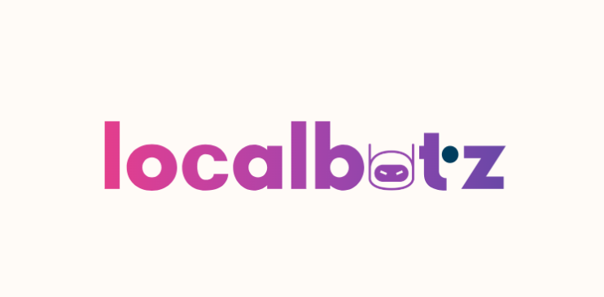

# Download LocalBotz



**Your own personal AI agent, on your own computer.**

LocalBotz is free, private by design, and runs on your own computer. You do not need to know how to use a terminal. **Just install LocalBotz — that's it.** You download one thing (LocalBotz), double-click one file, and it sets up everything else for you. No Git, no separate Python download, no separate LM Studio download, no separate model download.

**Get it here:** https://github.com/webginet-sys/localbotz

On that page, click the green **Code** button, then **Download ZIP**.

- Direct ZIP link: https://github.com/webginet-sys/localbotz/archive/refs/heads/main.zip
- Ready-made installers, when available: https://github.com/webginet-sys/localbotz/releases

---

## What you need first

- **A computer** — Windows 10 or 11, or a Mac with macOS 13 or newer.
- **Internet for the first setup** — to download LocalBotz and your AI model. After that, it works offline.

That's it. Python, LM Studio and the Qwen3.5 model (the AI brain that runs on your computer) are all downloaded and set up automatically by the installer in the next step. You do not download them separately.

---

## On Windows — 4 steps

1. **Click “Get LocalBotz for Windows”** on the download page, or go to https://github.com/webginet-sys/localbotz. Click the green **Code** button, then **Download ZIP**.
2. **Open the downloaded ZIP.** Find it in your Downloads folder, open it, and click **Extract All**. Choose a folder you will remember, for example your Desktop.
3. **Double-click `install.bat` (or `start.bat`).** It is in the folder you just extracted. A small black window will appear — that is normal, it is setting LocalBotz up for you. The first time it downloads Python, LM Studio and the Qwen3.5 model for you, so it takes a while (the model is about 6 GB). Please leave the black window open while you use LocalBotz.
4. **LocalBotz opens in your browser.** Your browser should open to `localhost:8000` — that is LocalBotz running on your own computer. If it does not open by itself, type `localhost:8000` into your browser's address bar.

To stop LocalBotz, just close the black window. To start it again, double-click `start.bat` again — the second time is fast, everything is already installed.

## On Mac — 4 steps

Works on Apple Silicon (M1 / M2 / M3 / M4) and Intel Macs — the same download works for both, you do not need to choose.

1. **Click “Get LocalBotz for Mac”** on the download page, or go to https://github.com/webginet-sys/localbotz. Click the green **Code** button, then **Download ZIP**.
2. **Open the ZIP.** Find it in your Downloads folder and double-click it. It will open into a folder called `localbotz`.
3. **Double-click `start.command`.** It is in the `localbotz` folder. If your Mac says it cannot be opened, right-click it (or hold Control and click), choose **Open**, then click **Open** again. A small window will appear — that is normal. The first time it downloads Python, LM Studio and the Qwen3.5 model for you, so it takes a while.
4. **LocalBotz opens in your browser.** Your browser should open to `localhost:8000` — that is LocalBotz running on your own computer. If it does not open by itself, type `localhost:8000` into your browser's address bar.

To stop LocalBotz, just close the Terminal window. To start it again, double-click `start.command` again.

---

## Questions people ask

**Is it free?**
Yes. LocalBotz itself is free, and the Qwen3.5 model in LM Studio is free. You only pay if you choose to use paid online models (like Claude or GPT) — and then only to that provider, if you add your own key.

**Is my data private?**
Yes. With the local model, your chats, files and browsing stay on your own computer. Nothing is sent to a cloud service unless you choose an online provider yourself.

**Do I need to type commands?**
No. You only need to download a ZIP, extract it, and double-click one file. There is a terminal version for developers in the README, but you do not need it.

**Do I need to download Python or LM Studio separately?**
No. Just install LocalBotz — that's it. The installer downloads and sets up Python, LM Studio and the Qwen3.5 model for you in that one step.

**What if it doesn't open?**
First, check that the small setup window is still open — LocalBotz stops when you close it. Then open your browser and type `localhost:8000` in the address bar. The first run downloads a lot (Python, LM Studio and a ~6 GB model), so give it time and keep your internet connected.

**What if LM Studio isn't running?**
LocalBotz will tell you it cannot reach LM Studio. Just double-click `start.bat` again — it sets LM Studio and Qwen3.5 up for you. Or open LM Studio yourself, make sure Qwen3.5 is loaded, press **Start Server** in the Developer tab, and try again. LocalBotz will reconnect automatically.

**Can I use Claude, GPT or Gemini instead?**
Yes, when you have internet. In LocalBotz, go to Settings → Connectors and add the key for the provider you want. You can use whichever model is available — local or online — and switch per bot.

---

## For developers

If you do use a terminal, the quick version is:

```bash
git clone https://github.com/webginet-sys/localbotz.git
cd localbotz
./start.sh        # Mac / Linux
start.bat         # Windows
```

See [README.md](README.md) for the full guide, and [download.html](download.html) for the same instructions as a web page.

Support: https://github.com/webginet-sys/localbotz/issues

---

MIT licensed and built in the open. Read the code, run it from source, or send a pull request: https://github.com/webginet-sys/localbotz/pulls
