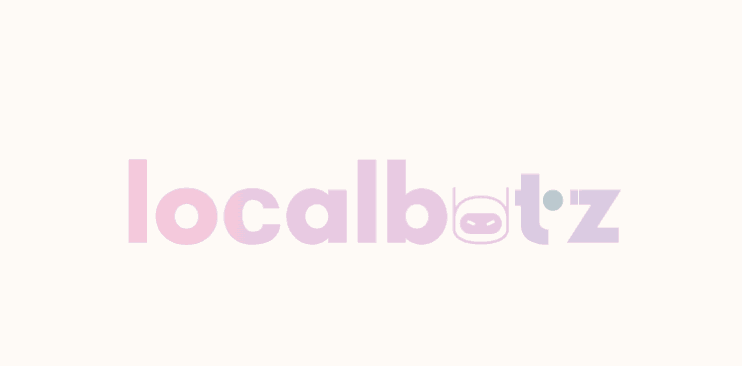

<!-- Static logo: assets/logo.png. Short video version: assets/logo-animated.mp4 -->

# LocalBotz — a simpler, fully local clone of AbacusAI Bot

A personal-agent app you run on your own computer. No Electron, no cloud,
no API keys. Bots have their own name, instructions/persona, model, chat
history and memory file. The agent can search the web, drive a real browser
(Playwright/Chromium), read/write files in `./workspace`, and run safe shell
commands — driven by a downloaded local model in **LM Studio**.

> **MIT licensed and built in the open.** [Read the code](https://github.com/webginet-sys/localbotz), run it from source, or [send a pull request](https://github.com/webginet-sys/localbotz/pulls).
>
> **Landing page:** [landing.html](landing.html) — also at `docs/index.html` for GitHub Pages. Same style as the Abacus AI Bot page: hero, try-it prompts, what you can build, open source, and download.

## Download — for everyone

**You do not need to know how to use a terminal.** If you have never
downloaded an app from GitHub before, start here:

- **Open the download page:** [download.html](download.html) — also at
  `docs/download.html` for GitHub Pages — or read the plain-language
  steps in [DOWNLOAD.md](DOWNLOAD.md).
- **🪟 [Download for Windows](https://github.com/webginet-sys/localbotz)** — Windows 10 / 11. On GitHub, click **Code → Download ZIP**, extract it, then double-click `start.bat`.
- **🍎 [Download for Mac](https://github.com/webginet-sys/localbotz)** — Apple Silicon (M1 / M2 / M3 / M4) and Intel. On GitHub, click **Code → Download ZIP**, open the ZIP, then double-click `start.command`.
- Then open your browser to `http://localhost:8000`. **Just install LocalBotz — that's it.** Double-click `install.bat` (Windows) or `start.command` (Mac) and it downloads and sets up Python, LM Studio and the Qwen3.5 model for you in that one step. No Git, no separate Python download, no separate LM Studio download.

GitHub repo: https://github.com/webginet-sys/localbotz

## Install — no Git needed

**You do not need Git, and you do not need a terminal.** Git is only for
developers who want to clone the code — normal users never need it.

1. Download the ZIP: https://github.com/webginet-sys/localbotz/archive/refs/heads/main.zip
   — or go to https://github.com/webginet-sys/localbotz and click
   **Code → Download ZIP**.
2. Extract the ZIP.
3. Run it — Windows: double-click `start.bat`, macOS: double-click
   `start.command`, Linux: `./start.sh`
   (first run: `chmod +x start.sh start.command`). The starter creates a
   venv, installs the dependencies and starts the app on
   http://localhost:8000. It only needs Python — no Git anywhere.

For developers only (optional, needs Git installed):

```bash
git clone https://github.com/webginet-sys/localbotz.git
cd localbotz
```

**Full install — everything upfront.** There is no lightweight install
any more. The installer always installs browser automation (Playwright
+ Chromium) in the same step, and verifies Chromium launches, so it is
ready before you need it. Nothing is left to install later — if you
need to run browser automation, whatever it needs is already there.
`--light` / `--no-browser` are no longer supported and are ignored.

**Works on Windows, macOS and Linux.** The code uses `pathlib` throughout,
no hardcoded OS paths and no OS-only shell commands — the file commands in
`run_command` (`ls`/`dir`, `cat`/`type`, `grep`, `find`, …) are implemented
in Python, so they behave the same on all three.

Inspired by [AbacusAI Bot](https://github.com/abacusai/abacusai-bot)
(MIT, Electron + TypeScript). This is a deliberately smaller re-implementation
in Python, not a fork of that repo.

## What it does

- **Bots** — create / list / select / delete bots, each with name,
  instructions, model, own chat (`data/chats/<id>.json`) and memory
  (`data/memory/<id>.json`). Starter templates: **Chief of Staff** and
  **Research Scout**. Stored as plain JSON in `data/` (`bots.json`).
- **Local model (LM Studio, default)** — talks to LM Studio's
  OpenAI-compatible local server at `http://localhost:1234/v1` via
  `/chat/completions`. Default model: **Qwen3.5** — set with
  `MODEL` / `LLM_MODEL` in `.env`, or per bot in the UI. You can use
  **any local model** you have in LM Studio or Ollama: the app asks the
  local server what it actually has (`GET /v1/models`) and lists those
  models in the **Available models** dropdown — Qwen3.5 is only the
  fallback when the list cannot be fetched.
  > If LM Studio shows a fuller identifier for your model, e.g.
  > `qwen/qwen3.5-...`, copy that **exact** identifier into `MODEL`
  > (or into the bot's Model field in the UI). The app sends whatever
  > is configured — it does not guess the identifier.
- **Agent tool loop** — up to 8 tool turns per reply, shown in the chat UI:
  `web_search` / `browser_search` (DuckDuckGo), `browser_open`,
  `browser_read`, `browser_screenshot` (saved to `data/screenshots/`),
  `browser_click`, `browser_type`, `list_files`, `read_file`, `write_file`
  (restricted to `./workspace`, never outside), `run_command` (allowlisted
  commands only, 30 s timeout, workspace as cwd, cross-platform).
- **Web UI** — http://localhost:8000 — sidebar with bots + New Bot form
  (including an editable Model field per bot), main chat, model + status
  indicator (LM Studio reachable / not reachable / mock), memory view,
  tool-output display. Plain HTML/JS, no build step.
- **Mock mode** — `python app.py --mock` or `MOCK_MODE=1`: test the UI,
  bots and tools without any model running.

## Quick start (all OS)

The start scripts do everything: check Python, create a venv, install
dependencies, install Playwright Chromium, then run the app.

- **Windows:** double-click `start.bat`, or in Command Prompt / PowerShell:
  `start.bat` (test mode: `start.bat --mock`)
- **macOS / Linux:** `chmod +x start.sh` (first time only), then
  `./start.sh` (test mode: `./start.sh --mock`)

Then open **http://localhost:8000**. LM Studio must be running first
(see step 2 in your OS section below).

---

## Windows

### 1. Install Python 3.11+
Download the installer from https://www.python.org/downloads/windows/
and run it. **Tick "Add python.exe to PATH"** on the first screen, then
Install. Check it worked — in Command Prompt *or* PowerShell:

```cmd
python --version
```

You should see `Python 3.11` or newer. If `python` is not recognised,
close and reopen the terminal (or reinstall with the PATH box ticked).

> PowerShell vs Command Prompt: both work for everything below.
> The only difference is running the script: in PowerShell type
> `.\start.bat` (the `.\` is required); in Command Prompt just
> `start.bat`. Double-clicking `start.bat` in Explorer also works.

### 2. LM Studio + Qwen3.5
1. Download LM Studio from https://lmstudio.ai/ and install it
   (the Windows `.exe` installer).
2. In LM Studio, search for and download the **Qwen3.5** model.
3. Load Qwen3.5 (open it in a chat, or load it from the model list).
4. Go to the **Developer tab** (left sidebar, `</>` icon) and press
   **Start Server**. It serves on `http://localhost:1234` by default.
   Leave LM Studio running while you use LocalBotz.
5. Note the exact model identifier LM Studio shows. The default in this
   app is `qwen3.5`. If LM Studio shows a fuller identifier, e.g.
   `qwen/qwen3.5-...`, set it exactly — copy `.env.example` to `.env`
   and set `MODEL=qwen/qwen3.5-...`, or set the Model field in the UI.

### 3. Run it

```cmd
start.bat
```

The script creates `.venv`, installs `requirements.txt`, installs
Playwright Chromium, and starts the app on http://localhost:8000.
To test without a model: `start.bat --mock`.

If you prefer manual steps, the equivalents are:

```cmd
python -m venv .venv
.venv\Scripts\activate
pip install -r requirements.txt
playwright install chromium
python app.py
```

---

## macOS

### 1. Install Python 3.11+
Either download it from https://www.python.org/downloads/macos/,
or with Homebrew:

```bash
brew install python
```

Check it:

```bash
python3 --version
```

You should see `Python 3.11` or newer. (macOS ships an old system
`python3` — the steps below always use `python3` explicitly, and the
start script creates its own venv, so the system Python is not used
to run the app.)

### 2. LM Studio + Qwen3.5
1. Download LM Studio from https://lmstudio.ai/ (macOS `.dmg`) and
   drag it to Applications.
2. In LM Studio, search for and download the **Qwen3.5** model.
3. Load Qwen3.5 (open it in a chat, or load it from the model list).
4. Go to the **Developer tab** (left sidebar, `</>` icon) and press
   **Start Server**. It serves on `http://localhost:1234` by default.
   Leave LM Studio running while you use LocalBotz.
5. Note the exact model identifier LM Studio shows. The default in this
   app is `qwen3.5`. If LM Studio shows a fuller identifier, e.g.
   `qwen/qwen3.5-...`, set it exactly — copy `.env.example` to `.env`
   and set `MODEL=qwen/qwen3.5-...`, or set the Model field in the UI.

### 3. Run it

```bash
chmod +x start.sh   # first time only
./start.sh
```

The script creates `.venv`, installs `requirements.txt`, installs
Playwright Chromium, and starts the app on http://localhost:8000.
To test without a model: `./start.sh --mock`.

Manual equivalent:

```bash
python3 -m venv .venv
source .venv/bin/activate
pip install -r requirements.txt
playwright install chromium
python app.py
```

---

## Linux

### 1. Install Python 3.11+
Ubuntu / Debian:

```bash
sudo apt update
sudo apt install python3 python3-venv python3-pip
```

Fedora:

```bash
sudo dnf install python3
```

Arch:

```bash
sudo pacman -S python
```

Check it:

```bash
python3 --version
```

You need `Python 3.11` or newer. If your distro ships an older Python,
install a newer one from https://www.python.org/downloads/ (or deadsnakes
on Ubuntu: `sudo add-apt-repository ppa:deadsnakes/ppa`).

### 2. LM Studio + Qwen3.5
1. Download LM Studio from https://lmstudio.ai/ (Linux AppImage) and
   make it executable / run it.
2. In LM Studio, search for and download the **Qwen3.5** model.
3. Load Qwen3.5 (open it in a chat, or load it from the model list).
4. Go to the **Developer tab** (left sidebar, `</>` icon) and press
   **Start Server**. It serves on `http://localhost:1234` by default.
   Leave LM Studio running while you use LocalBotz.
5. Note the exact model identifier LM Studio shows. The default in this
   app is `qwen3.5`. If LM Studio shows a fuller identifier, e.g.
   `qwen/qwen3.5-...`, set it exactly — copy `.env.example` to `.env`
   and set `MODEL=qwen/qwen3.5-...`, or set the Model field in the UI.

### 3. Run it

```bash
chmod +x start.sh   # first time only
./start.sh
```

The script creates `.venv`, installs `requirements.txt`, installs
Playwright Chromium, and starts the app on http://localhost:8000.
To test without a model: `./start.sh --mock`.

Manual equivalent:

```bash
python3 -m venv .venv
source .venv/bin/activate
pip install -r requirements.txt
playwright install chromium
python app.py
```

Note: `playwright install chromium` may ask for system libraries on
Linux; if it does, run `playwright install-deps chromium` (needs sudo)
or install the missing packages your distro suggests.

---

## Templates — Make a Bot

Click **＋ Make a bot** in the sidebar:

> A bot is a standing agent with its own instructions, schedule, memory and chats. Start from a template, or name one and describe the job.

- **Avatar picker** — 8 choices (🤖 👔 🔬 🌅 📰 📝 💬 👀), stored per bot.
- **Name your bot** + **Describe the job** — the job becomes part of the bot's instructions when you create it from scratch.
- **Template tabs** — Featured, Personal Assistant, Productivity, Research, More (More shows all 15 templates).
- **Template cards** — each has an icon, name and short description. Clicking one pre-fills name, instructions, avatar, provider/model (default LM Studio / Qwen3.5), enabled tools and schedule — all still editable before you press Create bot.

Templates (in `templates.json`, copied to `data/templates.json` on first run):

| Tab | Templates |
|---|---|
| Research | Deep Researcher, Competitor Watch, News Radar, Research Paper Scout, Decision Researcher |
| Personal Assistant | Chief of Staff, Email Drafting, Morning Brief, Meeting Prep, Follow-Up Tracker, WhatsApp Agent |
| Productivity | Task Planner, Meeting Notes, Research Scout, Inbox Triage |
| Featured | Deep Researcher, News Radar, Chief of Staff, Morning Brief, Task Planner, Research Scout |

Each template stores its full instructions, default tools and a schedule (e.g. `daily 07:00`, `on_demand`). The schedule is stored per bot and shown in the sidebar; scheduled *running* of bots is not built yet in v1 — bots run when you chat with them.

## Library

The **Library** section in the sidebar has 5 pages, sharing the same data files as Settings (no duplicate stores):

- **Connectors** — all model providers (LM Studio, Ollama, Claude, OpenAI, Gemini, OpenRouter, Groq, Mistral, Cerebras) plus service connectors (Gmail, Drive, Calendar, Slack, GitHub, Notion). Enable/disable, Test connection, status (reachable / missing key / offline). Service connectors that need OAuth are config + setup instructions in v1, with status **Not connected** — never faked.
- **Messaging** — WhatsApp, Telegram, Discord. Same data as Settings > Messaging channels: config, inbound-replies toggle (off by default), approved senders, status **Not connected** in v1.
- **MCP servers** — add/remove a server by name + command or URL (and env), enable/disable, Test. The test really runs the server (stdio JSON-RPC or HTTP `tools/list`) and lists its tools when it answers; if it cannot be reached, the error is shown. Stored in `data/mcp_servers.json`.
- **Skills** — built-in skills (Research, File help, Browser help, Coding help, Email drafting, Morning Brief) plus custom skills you add (name + instructions + optional source folder/file). Enable/disable per bot, delete custom ones. Stored in `data/skills.json`. Enabled skills are added to the bot's system prompt.
- **Tools** — the full built-in tool list (`browser_open`, `browser_read`, `browser_screenshot`, `browser_click`, `browser_type`, `browser_search`, `web_search`, `list_files`, `read_file`, `write_file`, `run_command`) with descriptions, global enable/disable, per-bot toggles, and which bots use each. Toggles are enforced in the agent loop.

## Settings

The **Settings** section in the sidebar has 7 pages, in this order:

1. **General** — default provider (LM Studio) + default model (Qwen3.5), workspace folder, theme (light/dark), data location, app version, reset settings. Persisted to `data/settings.json`.
2. **Connectors** — same provider/service connector list as Library > Connectors (shared store).
3. **Wallet** — local API spend tracking only, no real payments. Usage log per provider/model (calls, est. cost where known), monthly budget + alert, reset. Stored in `data/wallet.json`. Local models cost $0.
4. **Secure store** — local vault for API keys. Add/edit/delete a key per provider; stored in `.env` (gitignored). Keys are displayed **masked only** (e.g. `sk-...abcd`), never shown in full and never logged.
5. **Permissions** — global toggles (file read/write, shell, browser, web search, network) + per-bot approval mode (Ask / Auto / Full) + blocked paths. Enforced in the agent tool loop: Ask blocks mutating tools (write, shell, click/type); turning network off blocks online providers; blocked paths are refused by the file tools.
6. **Messaging channels** — same data as Library > Messaging (shared store).
7. **Devices** — this computer (hostname, OS, Python version, Playwright Chromium installed or not, LM Studio reachable or not), browser automation status, plus extra devices you add; remove extra devices (this computer cannot be removed).

## Using online providers (DeepSeek, Claude, OpenAI, Gemini, OpenRouter...)

Local mode works fully offline with no keys: LM Studio + Qwen3.5 is the default. When you have internet, you can also use online providers:

1. Get an API key from the provider (e.g. Anthropic Console for Claude, platform.openai.com for OpenAI, Google AI Studio for Gemini, openrouter.ai, console.groq.com, console.mistral.ai, cloud.cerebras.ai).
2. Add it in **Settings > Secure store** (masked, stored in `.env`), or add the line to `.env` yourself — see `.env.example` for the variable names (`DEEPSEEK_API_KEY`, `ANTHROPIC_API_KEY`, `OPENAI_API_KEY`, `GEMINI_API_KEY`, `OPENROUTER_API_KEY`, `GROQ_API_KEY`, `MISTRAL_API_KEY`, `CEREBRAS_API_KEY`). Keys are never hardcoded or committed.
3. Pick the provider + model per bot — in the **Make a Bot** form, or in the chat header (provider dropdown + model field, then Apply), or from the **Available models** dropdown, which only lists models that can actually work right now. Defaults: DeepSeek `deepseek-chat`, Claude `claude-sonnet-4-5`, OpenAI `gpt-4o-mini` (Codex: `gpt-5-codex` / `codex-mini-latest` if available on your account), Gemini `gemini-2.5-flash`, OpenRouter `openrouter/auto`, Groq `llama-3.3-70b-versatile`, Mistral `mistral-small-latest`, Cerebras `llama-3.3-70b`.
4. Check status in the sidebar status line or Library > Connectors > Test: it shows configured / missing key / reachable for the selected provider, without ever displaying the key.

The tool loop works the same for every provider. Claude uses its native Messages API (tool calls are translated to/from its format in `app.py`); the others use the standard OpenAI-compatible `/chat/completions` format.

**Fallback:** if an online provider fails (no key, no internet, API error), the chat shows a clear error and, if LM Studio is reachable, offers a one-click switch back to LM Studio (local, Qwen3.5). Usage (calls/tokens/est. cost) is recorded in the Wallet.

## Providers

| Provider | Key (env var) | Models | Notes |
|---|---|---|---|
| LM Studio (local) | — | any model in LM Studio (listed live) | Default. Offline, no key. |
| Ollama (local) | — | any model in Ollama (listed live) | Fallback local server. |
| DeepSeek | `DEEPSEEK_API_KEY` | `deepseek-chat` (default), `deepseek-reasoner` | OpenAI-compatible, https://api.deepseek.com/v1 |
| Claude | `ANTHROPIC_API_KEY` | `claude-sonnet-4-5` (default), `claude-opus-4-1` | Native Messages API. |
| OpenAI / Codex | `OPENAI_API_KEY` | `gpt-4o-mini` (default), `gpt-4o`, plus Codex models `gpt-5-codex` / `codex-mini-latest` if available on your account | Codex models need Codex access on the OpenAI account; if they are not available to you, pick `gpt-4o` / `gpt-4o-mini`. |
| Google Gemini (AI Studio) | `GEMINI_API_KEY` | `gemini-2.5-flash` (default), `gemini-2.5-pro` | Get a key in Google AI Studio. |
| OpenRouter | `OPENROUTER_API_KEY` | `openrouter/auto` (default) | One key, many models. |
| Groq | `GROQ_API_KEY` | `llama-3.3-70b-versatile` | |
| Mistral | `MISTRAL_API_KEY` | `mistral-small-latest` | |
| Cerebras | `CEREBRAS_API_KEY` | `llama-3.3-70b` | |
| Grok (xAI) | `XAI_API_KEY` | `grok-4` | Reference-only, from the ChatLLM model list — confirm the ID in xAI's docs. |
| Kimi (Moonshot AI) | `MOONSHOT_API_KEY` | `kimi-k2` | Reference-only, from the ChatLLM model list — confirm the ID in Moonshot's docs. |
| GLM (Zhipu AI) | `ZHIPU_API_KEY` | `glm-4.5` | Reference-only, from the ChatLLM model list — confirm the ID in Zhipu's docs. |
| VPS Premium | `VPS_API_TOKEN` (your token, not a provider key) | Claude Sonnet, GPT, Gemini — whatever the VPS offers | See below. No provider keys in the client. |

Model list reference: [ChatLLM (Abacus.AI)](https://chatllm.abacus.ai/) and
[abacus.ai](https://abacus.ai/) — see `models.json` and
`docs/chatllm-model-reference.md`. Their marketing names (GPT 6 Astra,
Fable 5.2, Gemini 4 Carbon, Grok-4.7, Kimi K3.1 Pro, GPT-6.1 Terra, …) are
**not** provider API IDs, so LocalBotz maps them to the closest real API IDs
above and only lists a model as usable when its provider is actually
available. Image models (Nano Banana Pro, GPT Image 2.6) and video models
(Seedance 2.5, Kling 4.0, Veo 3.1) from abacus.ai are reference-only —
LocalBotz does not generate images or videos yet.
**No Git is needed to run LocalBotz** — download the ZIP, extract it,
double-click `start.bat` (Windows) or `start.command` (Mac).

**Provider status** (Library / Settings → Connectors, and the Test button)
uses these exact states, stored with the last-checked time in
`data/connectors.json`:

- **Not connected** — no key is saved.
- **Saved, not checked** — a key is saved but has not been tested yet.
- **Connected** — the last Test succeeded (shown as "Saved" / "Connected").
- **Failed** — the last Test failed, with the error shown.

Keys are shown masked only (e.g. `sk-...abcd`) and never in full.

## Whichever model is available

You do not have to decide up front which model to use — the app shows
you what is actually usable **right now**:

- The **Available models** dropdown (chat header, and Make a Bot) is
  grouped by source — Local — LM Studio, Local — Ollama, Premium — VPS,
  Claude, OpenAI, Gemini, … — and is filled live from
  `GET /api/models/available`, which probes every source: LM Studio's
  `GET /v1/models`, Ollama's `GET /api/tags`, the VPS gateway's
  `GET /v1/models`, and the direct providers (listed only when their
  API key is configured). Press **↻ Models** to refresh it.
- A source that cannot work right now appears **greyed out with the
  reason** — e.g. "LM Studio not running", "no key", "VPS offline" —
  so you cannot pick a model that can't work without being told why.
- If a bot's saved model becomes unavailable (you unloaded it in LM
  Studio, the VPS went down, a key was removed), the chat says so
  plainly and suggests the nearest available model, with a **one-click
  switch** button. Local models work when LM Studio/Ollama is running,
  premium models when the VPS is reachable, direct providers when a
  key is set — use whichever is available.

## Premium models from a VPS

If Thomas (or you) runs the gateway in `server/` on a VPS, you can use
premium models — **Claude Sonnet, GPT, Gemini** — without putting any
provider API key on your own computer:

1. **On the VPS** (see `server/README.md` for the full deploy — SSH or
   Tailscale, systemd or Docker, nginx + Let's Encrypt for public
   access): copy `server/.env.example` to `server/.env`, set
   `PREMIUM_API_TOKEN` (a long random token you issue to users) and
   **your** provider keys (`ANTHROPIC_API_KEY`, `OPENAI_API_KEY`,
   `GEMINI_API_KEY`, `DEEPSEEK_API_KEY`, `OPENROUTER_API_KEY`). The
   premium model list is `PREMIUM_MODELS` in that file — default
   `claude-sonnet-4-5,gpt-4o,gpt-4o-mini,gemini-2.5-flash,gemini-2.5-pro`;
   add newer ids there (and `deepseek-chat` / `deepseek-reasoner` for
   DeepSeek) and restart the gateway.
2. **In the app:** Settings → Connectors → **VPS Premium** — paste the
   gateway base URL (e.g. `https://YOUR-VPS/v1`) and the token the VPS
   owner issued you, then **List premium models**. Or set in `.env`:
   `VPS_BASE_URL=https://YOUR-VPS/v1` and `VPS_API_TOKEN=<your token>`.
3. Pick provider **VPS Premium** per bot and choose a model from the
   live list the gateway returns.

Your provider keys stay on the VPS only — the client never holds them,
and the gateway never sends them back or writes them to logs. The
client only sends its own user token. If the VPS is unreachable or the
token is wrong, the app shows a clear error and falls back to the
local model (LM Studio).

## Operating models (Super Admin)

LocalBotz can run as a small platform, not just a single-user app.
There are three operating modes. The Super Admin (the owner) picks the
global default; each workspace can inherit it or override it.

Set `ADMIN_TOKEN` in `.env` (a long random token) to enable the
**👑 Super Admin** panel in the sidebar. Without it, the panel is
disabled and the app behaves as a single-user app in Selectable mode.

### Mode 1 — Master Managed Fixed (zero-configuration)

- The Super Admin enters the master platform API keys (Anthropic,
  OpenAI, DeepSeek, Gemini, OpenRouter, Groq, Mistral, Cerebras, VPS)
  in **Super Admin → Master platform keys** (stored in `.env`, masked),
  and assigns **one fixed default LLM** (+ one fixed Voice model).
- Tenants in this mode see **no provider/model picker at all** — every
  chat uses the fixed model. Zero configuration for the tenant.
- Usage is metered and billed to the workspace wallet (see below).

### Mode 2 — Master User-Selectable (curated roster)

- The Super Admin supplies the master keys (as above) and curates an
  allowed roster of LLM + Voice models (Super Admin → Model roster).
- Tenants can freely pick any model from that enabled roster, without
  entering any API key of their own.
- Usage is metered and billed to the workspace wallet, as in Mode 1.

### Mode 3 — BYOK (Bring Your Own Key)

- The tenant connects their **own** personal API keys in their
  workspace's Secure store (per provider).
- The host incurs **zero third-party API cost** for that workspace —
  usage is tracked only, at $0 host cost, and no wallet billing applies
  to API usage.
- A BYOK workspace with no key for a provider cannot use that provider
  until the tenant adds their own key.

**Local models (LM Studio / Ollama) are always free in all three modes**
— no key, no wallet, no metering charge.

### Workspaces / tenants

Workspaces live in `data/workspaces.json` and are switched from the
sidebar dropdown. Each workspace has: a name, an operating mode
(`inherit` = follow the global mode, or its own `fixed` / `selectable` /
`byok`), a wallet balance, and members (names only in v1). Bots are
shared across workspaces in v1; the mode, wallet, roster and keys are
what change per workspace.

### Wallets + metering

- Each workspace has its own wallet: balance, transaction log and usage
  history (`data/wallets/<workspace>.json`, plus `data/metering.jsonl`).
- The Super Admin tops a wallet up manually (Super Admin → Workspaces →
  Top up; no real payments in v0.3 — it is a recorded manual balance).
- Metering: tokens from the provider's usage counts when returned,
  otherwise estimated as characters ÷ 4; characters are counted too.
  Prices are per 1,000 tokens in/out per model (and per character for
  voice) in `data/pricing.json`, editable in Super Admin → Pricing.
- When a workspace wallet is **empty ($0.00)**, paid chats are blocked
  with a clear message (local models still work). Below the low-balance
  threshold (default $1.00, in pricing) the chat shows a warning.
- Every chat footer shows its cost, the wallet balance after the chat,
  the mode, and which key paid for it (`master` / `byok` / `local`) —
  the key itself is never logged or shown.

### Voice models

Roster entries have a type: `llm` or `voice`, plus provider, model id
and an enabled flag. Voice models (e.g. OpenAI `tts-1`, `tts-1-hd`,
`gpt-4o-mini-tts`) are selectable in the roster. TTS works through
`POST /api/voice/tts` via the provider's OpenAI-compatible endpoint
when a key is present (master or BYOK, per the workspace mode); when
no key is configured the endpoint returns an honest "not configured"
error — audio is never faked.

### Switching a workspace between modes

- **Globally:** Super Admin → Operating mode → pick Fixed, Selectable
  or BYOK → Save. Workspaces set to `inherit` follow it immediately.
- **Per workspace:** Super Admin → Workspaces → change that workspace's
  mode (or `PATCH /api/workspaces/<id>` with `{"mode": "byok"}`).
- The agent and the model picker enforce the mode on every chat:
  Fixed hides the picker, Selectable limits it to the roster, BYOK
  requires the tenant's own key for that provider (or a local model).

## If LM Studio is not running

The status indicator in the UI turns red and chat replies explain how to
start it (load Qwen3.5, Start Server in the Developer tab, check the model
id). Nothing is sent to any cloud service — the model, files and browser
all stay local.

## Ollama (alternative, fallback only)

If you prefer Ollama instead of LM Studio, set in `.env`:

```bash
LLM_BASE_URL=http://localhost:11434/v1
MODEL=<the model you pulled, e.g. qwen3.5 or llama3.1:8b>
```

then `ollama serve` and `ollama pull <model>`. LM Studio remains the
default; Ollama is not required.

## Configuration

| Setting | Default | Notes |
|---|---|---|
| `LLM_BASE_URL` | `http://localhost:1234/v1` | LM Studio; Ollama fallback: `http://localhost:11434/v1` |
| `MODEL` / `LLM_MODEL` | `qwen3.5` | Exact id shown in LM Studio; per-bot model overrides this in the UI |
| `MOCK_MODE` | off | `1` or `--mock` to test without a model |
| `PORT` | `8000` | `python app.py --port 8000` |
| `HOST` | `127.0.0.1` | Local only by default |

Copy `.env.example` to `.env` to set these persistently.

## API (for scripts / curl)

```
GET  /health                    # status, provider, model, LM Studio reachability
GET  /api/status                # {provider, llm_base_url, model, llm_reachable, lm_studio_reachable}
GET  /api/templates
GET  /api/models/available     # live probe: only models usable right now, grouped by source
GET  /api/providers/{id}/models # live list for one provider (LM Studio/Ollama/VPS/…)
GET  /api/vps/config           # VPS Premium base URL + token status (masked)
GET  /api/vps/models           # premium models the VPS gateway offers
GET  /api/tools
GET  /api/bots                  # list bots
POST /api/bots                  # {"name","instructions","model","template"}
GET  /api/bots/{id}/chat
POST /api/bots/{id}/chat        # {"message": "..."} -> {"reply","tools"}
POST /api/bots/{id}/chat/reset
GET  /api/bots/{id}/memory
POST /api/bots/{id}/memory      # {"fact": "..."}
GET  /screenshots/<file>        # browser screenshots
```

The status check probes `GET {LLM_BASE_URL}/models` and reports whether
LM Studio (or the configured provider) is reachable.

## Project layout

```
app.py                 FastAPI app + agent tool loop + LLM client (pathlib, cross-platform)
static/index.html      Single-page UI: chat, Make a Bot, Library, Settings (no build step)
static/logo.png        LocalBotz logo (also in assets/logo.png)
static/logo-animated.svg  Animated logo used in the app header (robot blinks, letters rise in)
static/logo-animated.gif  Animated logo (pulse, shimmer, dot bounce, blink)
assets/logo.png        LocalBotz logo for the GitHub repo / README
assets/logo-animated.svg  Animated wordmark (SVG, standalone in a browser)
assets/logo-animated.gif  Animated logo for the README top
assets/logo-animated.mp4  Animated logo, 4 s video (also .webm) for social / README
templates.json         15 shipped bot templates (copied to data/templates.json)
start.bat              Windows starter (venv + core deps, browser optional + run)
start.sh               macOS/Linux starter (venv + core deps, browser optional + run)
requirements.txt       Core: fastapi, uvicorn, httpx (full install also adds requirements-browser.txt: Playwright + Chromium)
requirements-browser.txt  Optional: playwright (browser automation)
server/                VPS Premium gateway (FastAPI): app.py, requirements.txt,
                       Dockerfile, .env.example, README.md (SSH/Tailscale deploy)
.env.example           LLM_BASE_URL / MODEL (qwen3.5) / VPS_BASE_URL + VPS_API_TOKEN /
                       all optional provider API keys
LICENSE                MIT — copyright Thomas
CONTRIBUTING.md        How to contribute (no secrets in commits, local-first)
SECURITY.md            How keys are protected, how to report a vulnerability
workspace/             The ONLY folder bots can read/write (welcome.txt inside)
data/                  bots.json, chats/, memory/, screenshots/, templates.json,
                       settings.json, connectors.json, mcp_servers.json, skills.json,
                       wallet.json, permissions.json, messaging.json, devices.json
                       (created at runtime; .env holds keys, gitignored)
```

## Safety notes

- Bots run with the tools above, but files are sandboxed to `./workspace`
  and shell commands are allowlisted with shell metacharacters
  (`; & | \` $ > <`) rejected and a 30 s timeout. File commands are
  implemented in Python, so they cannot invoke a platform shell at all.
- The server binds to `127.0.0.1` by default — only your computer can reach it.
- Keep it that way if you connect messaging apps later; do not expose it
  publicly without authentication.

## What this is NOT (yet)

Compared with AbacusAI Bot: no live WhatsApp/Telegram/Discord messaging
(config + approved senders only, status Not connected), no live
Gmail/Drive/Calendar connectors (config + setup instructions only), and
no scheduled routines — a bot's schedule (e.g. `daily 07:00`) is stored
and shown, but nothing runs it yet; bots run when you chat with them.
MCP servers *are* in v1: add one in Library > MCP servers and Test really
runs it (stdio JSON-RPC or HTTP `tools/list`) and lists its tools.
Those gaps are the natural next steps — the bot/tool structure in `app.py`
(`TOOLS`, `run_agent`) is where they would plug in.

---

MIT licensed and built in the open. [Read the code](https://github.com/webginet-sys/localbotz), run it from source, or [send a pull request](https://github.com/webginet-sys/localbotz/pulls).
